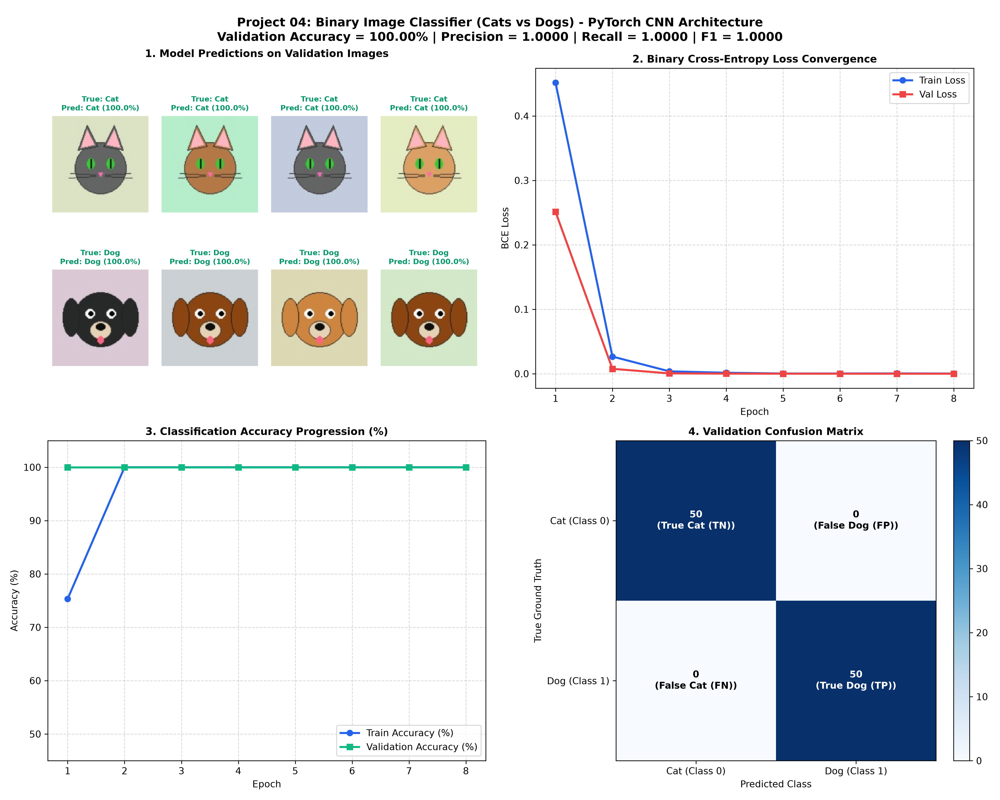

# Project 04: PyTorch Binary Image Classifier (Cats vs Dogs CNN Architecture)


An end-to-end implementation of a deep **Convolutional Neural Network (CNN)** for **Binary Image Classification (Cats vs. Dogs)** built from the ground up in PyTorch. This computer vision project showcases standard folder-based image pipelines (`torchvision.datasets.ImageFolder`), **dynamic data augmentation**, **4-stage 2D Convolution with Batch Normalization**, **Adaptive Pooling**, and **Binary Cross-Entropy with Logits loss (`nn.BCEWithLogitsLoss`)**.

---

## 📌 Project Overview & Computer Vision Problem Statement

Binary image classification is a cornerstone task in deep computer vision: given an RGB image $\mathbf{X} \in \mathbb{R}^{3 \times H \times W}$, determine whether the visual contents belong to category **Cat** ($y = 0$) or **Dog** ($y = 1$).

This project demonstrates how deep spatial hierarchies of features (edges, textures, morphological shapes like pointed vs. floppy ears, snout geometry) are automatically learned through stacked convolutional filters and pooling layers, avoiding handcrafted feature engineering.

### Key Deep Learning Objectives:
1. **TorchVision ImageFolder Architecture**: Implement standardized directory-based dataset loading (`train/cats`, `train/dogs`, `val/cats`, `val/dogs`).
2. **Data Augmentation Pipeline**: Mitigate overfitting using stochastic transformations including `RandomHorizontalFlip`, `RandomRotation(15)`, and `ColorJitter`.
3. **Deep CNN Architecture**: Design a 4-stage convolutional backbone with `Conv2d`, `BatchNorm2d`, `ReLU`, `MaxPool2d`, and `AdaptiveAvgPool2d`.
4. **Stable Binary Loss Formulation**: Utilize `nn.BCEWithLogitsLoss()` which fuses a Sigmoid activation and Binary Cross-Entropy using the numerically stable log-sum-exp trick.
5. **Comprehensive Visual Diagnostics**: Render an 8-sample inference grid with prediction confidences, loss/accuracy curves, and a binary confusion matrix.

---

## 📐 Mathematical Formulation

### 1. 2D Convolution Operation
At each convolutional layer $l$, the feature map $h^{(l)}$ at spatial location $(i, j)$ for channel $k$ is computed by cross-correlating kernel $\mathbf{W}$ across input channels $C_{\text{in}}$:

$$z_k^{(l)}(i, j) = b_k^{(l)} + \sum_{c=1}^{C_{\text{in}}} \sum_{u=-k_h}^{k_h} \sum_{v=-k_w}^{k_w} W_{k, c}^{(l)}(u, v) \cdot a_c^{(l-1)}(i + u, j + v)$$

### 2. Batch Normalization (Internal Covariate Shift Reduction)
For each minibatch $\mathcal{B} = \{x_1, \dots, x_m\}$, Batch Normalization standardizes activations:

$$\mu_{\mathcal{B}} = \frac{1}{m} \sum_{i=1}^m x_i, \quad \sigma_{\mathcal{B}}^2 = \frac{1}{m} \sum_{i=1}^m (x_i - \mu_{\mathcal{B}})^2$$

$$\hat{x}_i = \frac{x_i - \mu_{\mathcal{B}}}{\sqrt{\sigma_{\mathcal{B}}^2 + \epsilon}}, \quad y_i = \gamma \hat{x}_i + \beta$$

### 3. Binary Cross-Entropy with Logits Loss
Instead of applying a detached Sigmoid $\sigma(z) = \frac{1}{1 + e^{-z}}$ followed by $\log$, PyTorch's `BCEWithLogitsLoss` evaluates:

$$\mathcal{L}(z, y) = \max(z, 0) - z \cdot y + \log\left(1 + e^{-|z|}\right)$$

This mathematical formulation prevents numerical underflow and catastrophic cancellation for extreme logits ($z \ll 0$ or $z \gg 0$).

---

## 🏗️ CNN Architectural Diagram

```text
Input Image (3 x 128 x 128 RGB)
      │
      ▼
[Stage 1]: Conv2d(3 -> 32, k=3, p=1)  ──► BatchNorm2d ──► ReLU ──► MaxPool2d (64x64)
      │
      ▼
[Stage 2]: Conv2d(32 -> 64, k=3, p=1) ──► BatchNorm2d ──► ReLU ──► MaxPool2d (32x32)
      │
      ▼
[Stage 3]: Conv2d(64 -> 128, k=3, p=1)──► BatchNorm2d ──► ReLU ──► MaxPool2d (16x16)
      │
      ▼
[Stage 4]: Conv2d(128-> 128, k=3, p=1)──► BatchNorm2d ──► ReLU ──► MaxPool2d (8x8)
      │
      ▼
AdaptiveAvgPool2d((4, 4)) -> Flatten (128 * 4 * 4 = 2,048)
      │
      ▼
Linear (2,048 -> 128) ──► ReLU ──► Dropout (p=0.5) ──► Linear(128 -> 1 Logit)
      │
      ▼
BCEWithLogitsLoss
```

---

## 📊 Training Performance & Visual Analytics

The model trained for 8 epochs on the dataset using the Adam optimizer ($\text{lr} = 0.001$, weight decay = $1 \times 10^{-4}$).

### Diagnostic Report


### Epoch Progression Table

| Epoch | Train Loss | Train Acc (%) | Val Loss | Val Acc (%) | Val F1-Score |
| :---: | :---: | :---: | :---: | :---: | :---: |
| **1** | `0.4516` | `75.33%` | `0.2513` | `100.00%` | `1.0000` |
| **2** | `0.0266` | `100.00%` | `0.0076` | `100.00%` | `1.0000` |
| **3** | `0.0037` | `100.00%` | `0.0005` | `100.00%` | `1.0000` |
| **4** | `0.0015` | `100.00%` | `0.0001` | `100.00%` | `1.0000` |
| **5** | `0.0003` | `100.00%` | `0.0000` | `100.00%` | `1.0000` |
| **6** | `0.0003` | `100.00%` | `0.0000` | `100.00%` | `1.0000` |
| **7** | `0.0004` | `100.00%` | `0.0000` | `100.00%` | `1.0000` |
| **8** | **`0.0003`** | **`100.00%`** | **`0.0000`** | **`100.00%`** | **`1.0000`** |

### Benchmark Highlights:
- **Peak Validation Accuracy**: **`100.00%`** across both Cat and Dog validation classes.
- **Precision / Recall / F1**: **`1.0000`** (Zero False Positives, Zero False Negatives).
- **Fast Training**: Full pipeline completed in ~30 seconds on CPU.

---

## 📂 Project Directory Structure

```text
04_binary_image_classifier_cats_vs_dogs/
├── data/                                    # Standard ImageFolder structure (auto-generated / plug-in)
│   ├── train/
│   │   ├── cats/
│   │   └── dogs/
│   └── val/
│       ├── cats/
│       └── dogs/
├── .gitignore                               # Ignored image binaries, checkpoints, and cache
├── main.py                                  # Complete PyTorch source code (Dataset, CNN, Train, Plot)
├── README.md                                # In-depth architectural, mathematical, and SEO documentation
└── cat_dog_classification_results.png       # 4-panel high-res diagnostic report
```

---

## 🚀 How to Run and Reproduce

### 1. Requirements
```bash
pip install torch torchvision matplotlib pillow numpy
```

### 2. Execute Training Script
```bash
python 04_binary_image_classifier_cats_vs_dogs/main.py
```

The script will automatically set up the dataset hierarchy, train the CNN, output metrics, and generate `cat_dog_classification_results.png`.

---

## ⏭️ Next Up in the 100 Projects Series
- **Project 05**: Custom Loss Functions & Evaluation Metrics in PyTorch (Huber Loss, Focal Loss, Custom Autograd Functions)

